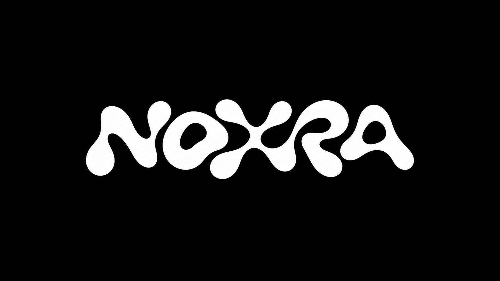
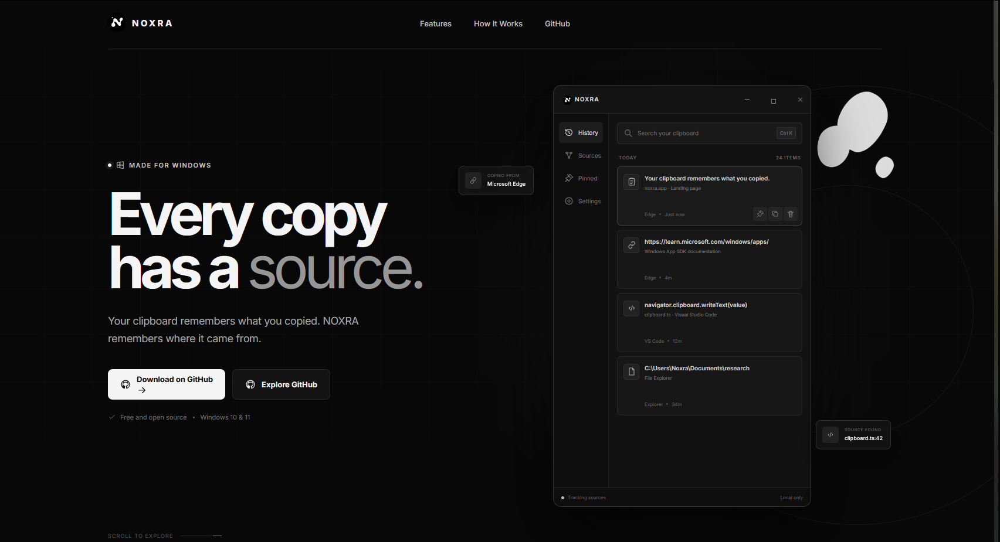
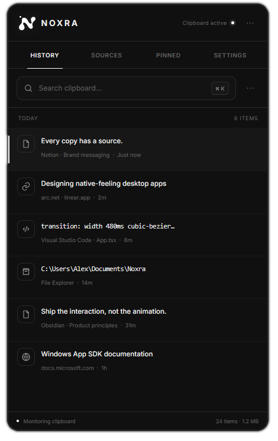
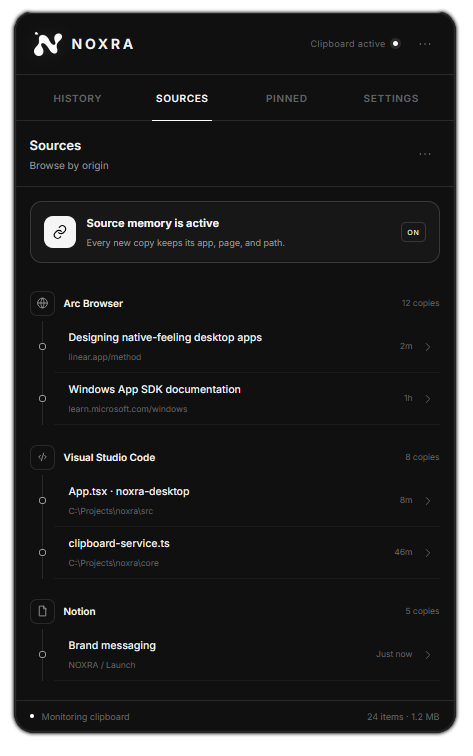
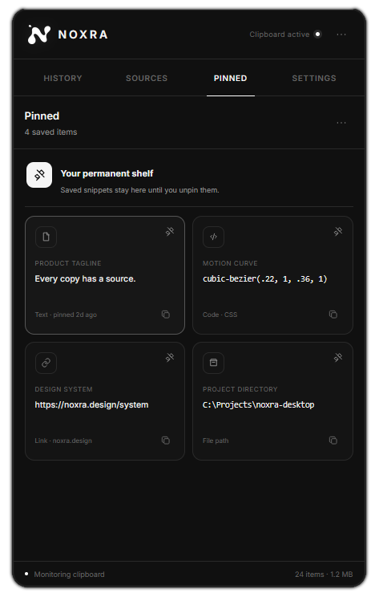
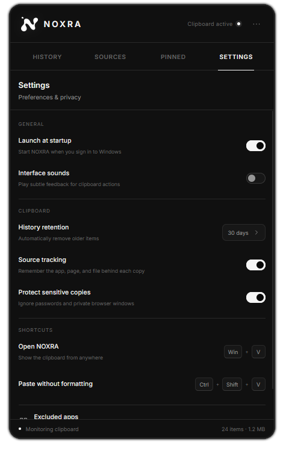

<p align="center">
  
</p>

<h1 align="center">Noxra</h1>

<p align="center">
  <strong>Zero-touch clipboard shelf & file-transfer hub that stays invisible until you need it.</strong><br/>
  <em>Fastened to your screen edge - just move your cursor closer to reveal, grab, and drop assets into any application instantly.</em><br/>
</p>


<p align="center">
  <a href="https://github.com/aa27259/Noxra/stargazers"></a>
  <a href="https://github.com/aa27259/Noxra/releases"></a>
  <a href="https://github.com/aa27259/Noxra/blob/main/LICENSE"></a>
  <a href="https://github.com/aa27259/Noxra/issues"></a>
</p>

<p align="center">
  <a href="#-about">About</a> •
  <a href="#-key-features">Features</a> •
  <a href="#-tech-stack">Tech Stack</a> •
  <a href="#-installation">Installation</a> •
  <a href="#-usage">Usage</a> •
  <a href="#-roadmap">Roadmap</a>
</p>


---

> **Disclaimer**
> Noxra is a standalone, open-source productivity utility. It operates completely independently and is not associated with, sponsored by, or affiliated with Microsoft, Apple, or any other trademarked platform.

# Why Noxra?
Most clipboard tools destroy your momentum. You copy an item, alt-tab to another window, open a clunky tray menu or press <kbd>**Win**</kbd> + <kbd>**V**</kbd>, scroll through history, press Enter, and only then paste. It’s slow, multi-step, and context-breaking.

Noxra eliminates the friction.
It anchors invisibly to the edge of your monitor as a lightweight, click-through overlay. The moment your cursor touches the edge, the shelf instantly springs open. Drag code snippets, screenshots, file bundles, and links directly into any active application — without hotkey hunting, app-switching, or modal popups.

Preview
---
> All demos are fast-loading, silent autoplay loops.

<h3 align="center">Landing Page: Welcome to Noxra!</h3>

<p align="center">
  <em>Instant hover activation, smooth physics animations, and effortless drag-and-drop into any workspace.</em>
</p>

<p align="center">
  
</p>

<br/>

<table>
  <tr>
    <td width="50%" align="center">
      <b>01. History</b><br/>
      <sub>Recent clipboard activity.</sub><br/><br/>
      
    </td>
    <td width="50%" align="center">
      <b>02. Sources</b><br/>
      <sub>Original context preserved.</sub><br/><br/>
      
    </td>
  </tr>
  <tr>
    <td width="50%" align="center">
      <b>03. Pinned</b><br/>
      <sub>Reusable saved snippets.</sub><br/><br/>
      
    </td>
    <td width="50%" align="center">
      <b>04. Settings</b><br/>
      <sub>Control and privacy.</sub><br/><br/>
      
    </td>
  </tr>
</table>

# Download

<p align="center">
  <b>Select your weapon — Windows 10 & 11:</b>
</p>

<p align="center">
  <a href="https://github.com/aa27259/Noxra/releases/latest">
    
  </a>
</p>

<p align="center">
  <sub>Get the latest version for Windows • Free & Open Source</sub>
</p>

# Features

- **Zero-Click Edge Dock:** Hover near the screen edge (Left, Right, or Top) to instantly open the shelf. Fully transparent and click-through when collapsed.
- **Multi-Monitor & Smart Seam Guard:** Seamless multi-display support with physical resolution scaling, 140ms boundary dwell protection, and cross-reboot persistence.
- **Fullscreen & Game Detection:** Automatically suppresses edge hover during games (VALORANT, Cyberpunk) or full-screen apps.
- **Multi-Format Clipboard Engine:** Captures text, URLs, images, spreadsheets, and multi-file stacks with smart deduplication and incognito privacy mode.
- **0ms Universal Drag & Drop:** Pre-staged OLE drag mechanics to drag images, code, or files directly into any active application.
- **Instant Search & Elastic Filters:** Live fuzzy search, time-based history clearing, and category filters (Text, Images, Files, Links, Colors).
- **Smart Stacks & File Bundles:** Auto-groups multi-file copies into 3D card stacks with expandable preview flyouts and single-click splitting.
- **Obsidian Dark UI & Anti-Blur Optimization:** Ultra-fast GPU-accelerated interface with ClearType text, customizable typography scale, and 31-language i18n support.
- **Synthesized Haptic Audio:** Zero-asset Web Audio API engine providing subtle tactile sound feedback for micro-interactions.
- **Low RAM Footprint:** Disk-backed payloads for large texts (>300 chars) lock operational memory to ~130 MB.
- **Silent Auto-Updates:** Background updating via GitHub Releases with live download progress badges or Microsoft Store MSIX builds.

# Project Structure

```
Edge-Drop/
├─ shared/                 Typed IPC contracts & domain models
│  ├─ types.ts             ClipboardItem, Bundle, Settings, DragRequest DTOs
│  ├─ bridge.ts            EdgeApi preload interface
│  └─ ipc.ts               InvokeMap / EventMap / SendMap channel definitions
├─ electron/               Node.js backend & OS integrations
│  ├─ main/
│  │  ├─ index.ts          Single-instance lock, IPC registration, startup
│  │  ├─ window.ts         Frameless window, setIgnoreMouseEvents, cursor poll, Win32 NOACTIVATE
│  │  ├─ updater.ts        Background auto-update engine (electron-updater)
│  │  ├─ tray.ts           System tray icon & context menus
│  │  ├─ fullscreen.ts     Windows SHQueryUserNotificationState game detection
│  │  ├─ drag.ts           OLE startDrag, temp-file staging, icon generation
│  │  ├─ stickProbe.ts     Pure geometric screen probe, versioned display cache
│  │  ├─ imageProtocol.ts  edgelocal:// image + thumbnail protocol
│  │  └─ stagedTemp.ts     Staged-temp artifact lifecycle manager
│  ├─ preload/             Sandbox bridge exposing window.edge
│  ├─ clipboard/
│  │  ├─ ClipboardWatcher.ts   600ms poll loop, transient-copy rejection
│  │  └─ formats.ts        FNV-1a signatures, Win32 HDROP, spreadsheet parsing, privacy flags
│  └─ store/
│     ├─ ItemStore.ts      Atomic JSON persistence, DPAPI encryption, dedup
│     ├─ settings.ts       User config & startup registration
│     └─ paths.ts          AppData + temp directory resolution
├─ src/                    React renderer
│  ├─ components/          Panel, Header, ItemList, ClipboardItem, ShelfSearch, RubberSegment, EmojiPicker, EmojiCategoryBar, PreviewFlyout, Settings, HotkeyRecorder, Toast, Icons
│  ├─ hooks/               useEdgeHover (hysteresis), useDragOut, useFilteredItems, useAdaptiveSpring, useRelativeTimeTick
│  ├─ lib/                 soundEffects (Web Audio API), theme tokens, format helpers, urlPreview, colorUtils, tryPaste, searchFocus
│  ├─ store/               Zustand appStore
│  └─ styles/              tokens.css, panel.css, settings.css, item.css, emoji.css, RubberSegment.css, global.css
```

# License

MIT License — see [LICENSE](LICENSE). Commercial and non-commercial use, modification, and distribution all permitted with attribution.

---

<p align="center">
  <sub>Support Noxra Star on <a href="https://github.com/Deepender25/Edge-Drop" target="_blank">GitHub ⭐</a></sub>
</p>
